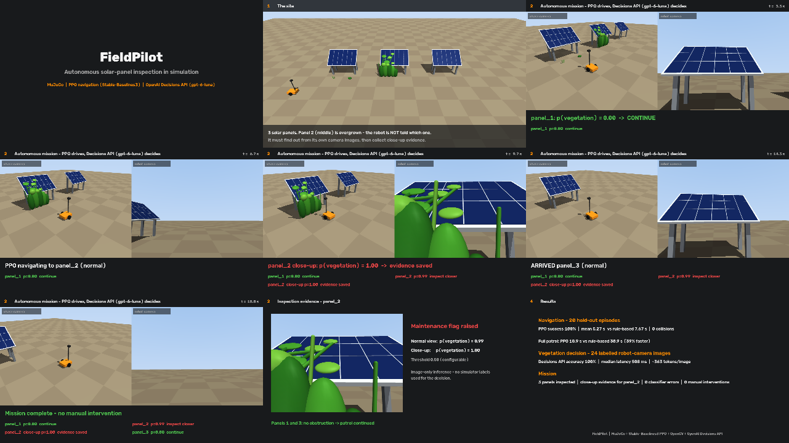
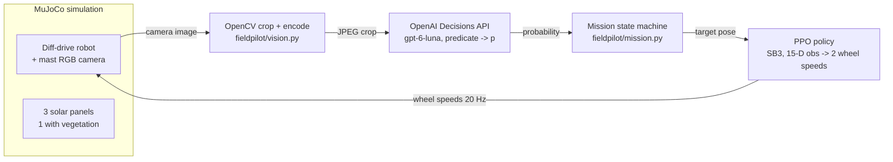
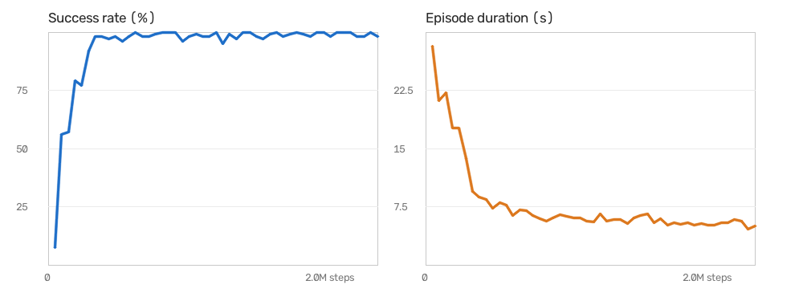
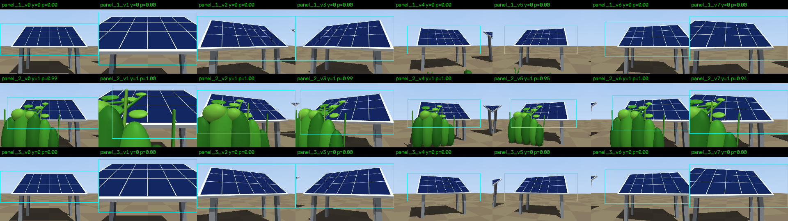

# FieldPilot

**A simulated wheeled robot that patrols solar panels, drives with a trained PPO policy, and asks
the OpenAI Decisions API whether vegetation is obstructing each panel. If the answer is yes, it
drives closer and captures evidence.**

A small end-to-end MVP: 3D simulation, reinforcement learning, a camera pipeline and AI decisions
working together in one loop. It is a portfolio project, not a production robotics stack.



▶ **Demo video (≈55 s):** [`docs/fieldpilot_demo.mp4`](docs/fieldpilot_demo.mp4)

---

## What happens in the demo

1. **The site.** A MuJoCo field with 3 solar panels. Panel 2 is partly covered by bushes and vines.
   The robot is not told which panel is affected.
2. **Navigation (PPO).** A Stable-Baselines3 PPO policy drives the differential-drive robot to each
   inspection pose and stops facing the panel. It outputs left and right wheel speeds at 20 Hz.
3. **Perception and decision.** The robot's own RGB camera image is cropped with OpenCV and sent to
   the **OpenAI Decisions API (`gpt-6-luna`)** with one predicate: *"Vegetation is visibly
   obstructing or covering part of the solar panel."* The API returns a probability.
4. **Mission logic.** If p ≥ threshold (default 0.5), PPO drives to a close-up pose and the robot
   saves an evidence photo. Otherwise it continues the patrol. When all panels are done it returns
   home, with no manual intervention.

## Architecture



The state machine: `NAVIGATE_TO_PANEL → CAPTURE → EVALUATE → (NAVIGATE_CLOSER → CAPTURE_EVIDENCE) → NEXT_PANEL → … → RETURN_HOME → DONE`

| Component | Choice | Notes |
|---|---|---|
| Simulation | MuJoCo 3.17 | Primitives only. Velocity-servo wheels, frictionless casters, 2 ms physics step |
| Navigation | SB3 PPO, MLP 128×128 | Goal = pose (x, y, yaw). Success = within 0.15 m and 10°, **and stopped** |
| Baseline | Rule-based go-to-pose controller | Turn, drive, then align. Used for comparison only, never as a hidden fallback |
| Vision | OpenCV | Crop around the blue panel blob. No YOLO, SAM or other learned models |
| Decision | Decisions API, `gpt-6-luna` | Predicate question returns a calibrated probability. Configurable threshold |
| Robustness | Failure fallback | Any API error or refusal: log it, then inspect closer (the safe default) |

The decision uses image inference only. Simulator labels (which panel has vegetation) are used only
to grade results, never as an input. The API is never called during PPO training.

## Quick start (macOS, Apple Silicon, Python 3.12)

```bash
git clone https://github.com/selim-ba/mvp-robot-decision-api.git && cd mvp-robot-decision-api
uv venv -p 3.12 && source .venv/bin/activate && uv pip install -r requirements.txt
cp .env.example .env                 # then set OPENAI_API_KEY (never committed)

python scripts/demo.py               # full mission + 55 s demo video -> outputs/demo/
python scripts/demo.py --mock        # same, fully offline (mock classifier, labelled as such)
python scripts/evaluate.py           # every benchmark -> outputs/results/summary.md
python scripts/view.py --ppo         # watch PPO drive in the MuJoCo viewer
python scripts/compare.py            # PPO vs rule-based "ghost race" in one MuJoCo window
```

Retrain the policy: `python scripts/train_ppo.py` (2M steps, about 3 min on an M4 Pro CPU).

## Results

Measured on a MacBook Pro M4 Pro. Full tables: `outputs/results/summary.md` (from `scripts/evaluate.py`).

**Navigation: 20 held-out episodes** (random start, random or inspection target; same tasks for both controllers)

| | PPO | Rule-based |
|---|---|---|
| Success (reach pose and stop) | **20/20** | 20/20 |
| Collisions / timeouts | 0 / 0 | 0 / 0 |
| Mean time to goal | **5.3 s** | 7.7 s |
| Mean path length | 4.15 m | 4.02 m |
| Full 7-stop patrol | **18.9 s** | 30.9 s |

PPO is about 39% faster on the patrol because it turns and drives at the same time. Both use the
same top speed (0.9–0.96 m/s). Training took 2M steps in 2.8 min (8 parallel envs, about 11.8k
steps/s on CPU).



**Vegetation decision: 24 labelled robot-camera images** (8 viewpoints × 3 panels; 8 obstructed)

| | Decisions API (gpt-6-luna) | Offline mock |
|---|---|---|
| Accuracy / precision / recall | **100% / 100% / 100%** | 100% / 100% / 100% |
| p(vegetation), obstructed images | 0.94 – 1.00 | 0.98 |
| p(vegetation), clear images | 0.00 | 0.02 |
| Latency, median / p95 | 508 ms / 941 ms | < 1 ms |
| Input tokens per image | ~363 | – |

The clear set includes low grass tufts near panel 1 that do not cover it. The API scored them 0.00.
Latency varies from run to run: an earlier identical run measured a 266 ms median, with a 2.4 s
cold-start maximum. Accuracy and probabilities were identical across both runs.



**Full mission**

| Scenario | Panel 1 | Panel 2 | Panel 3 | Outcome |
|---|---|---|---|---|
| Decisions API | p=0.00 → continue | **p=0.99 → close-up** (evidence p=1.00) | p=0.00 → continue | Completed, 18.0 s sim, 4 API calls, 0 errors |
| Mock classifier | 0.02 → continue | 0.98 → close-up | 0.02 → continue | Completed |
| API forced to fail (invalid key) | error → close-up | error → close-up | error → close-up | Completed; 6/6 errors handled |

## Limitations (read before judging)

- **Easy, synthetic scene.** The vegetation is large, saturated green and on one panel only. The 100%
  accuracy shows that the pipeline works end to end. It is not evidence of real-world robustness.
  The mock's perfect score just reflects how distinctive green is in this scene.
- **Easy navigation task.** The workspace in front of the panels has no obstacles, so the rule-based
  baseline also succeeds every time. PPO's advantage here is speed and smoothness, not success rate.
  The collision penalty exists but rarely triggers.
- **No sim-to-real work.** There is no sensor noise, domain randomisation, localisation error or
  realistic terrain. The robot uses its true simulated pose.
- **Blocking API calls.** The simulation pauses while it waits for the API. A real robot would have
  to hold position or keep moving during the 0.2–2.4 s latency.
- **Single training seed and single API run per image.** No variance estimates.
- **Fixed inspection waypoints.** There is no mapping, planning or SLAM, by design (out of scope).

## Repository layout

```
fieldpilot/
  assets/field.xml   MuJoCo world: robot, 3 panels, vegetation, cameras, ghost robot (comparison only)
  sim.py             FieldSim wrapper: reset / step / pose / collisions / rendering
  nav_env.py         Gymnasium env for goal-conditioned navigation (PPO)
  controller.py      Rule-based go-to-pose baseline
  waypoints.py       Normal and close-up inspection poses, derived from the model
  vision.py          OpenCV crop / encode
  decisions.py       Decisions API classifier: threshold, mock mode, failure fallback
  mission.py         Inspection state machine
  race.py, video.py  Ghost-race helpers, video writers
scripts/             demo, evaluate, train_ppo, eval_nav, phase{1,3,4}_*, view, compare, check_env
models/ppo_nav.zip   Trained policy used for every result above
docs/                README figures and the demo video
```

Development followed five gated phases (simulation → RL → vision/API → integration → evaluation),
documented in `CLAUDE.md`.
